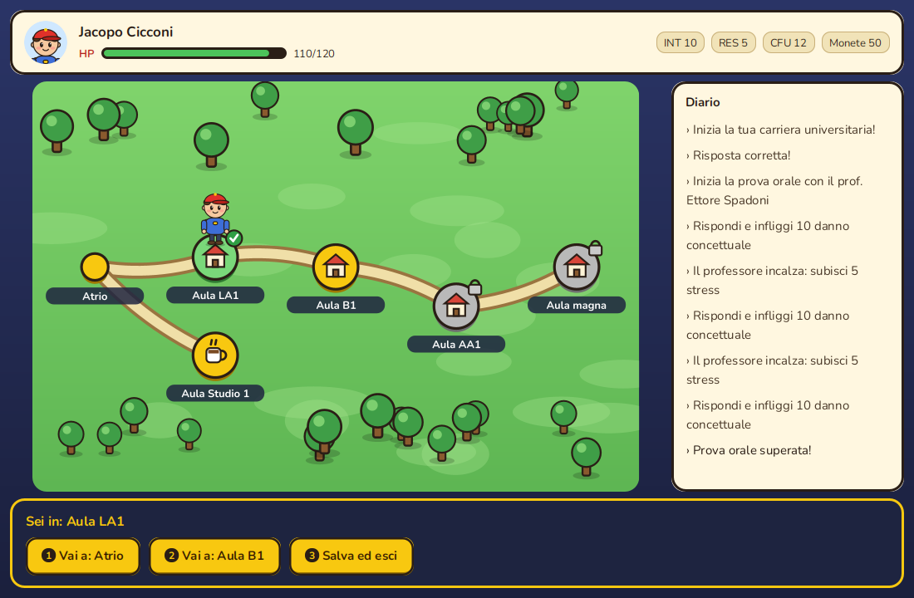
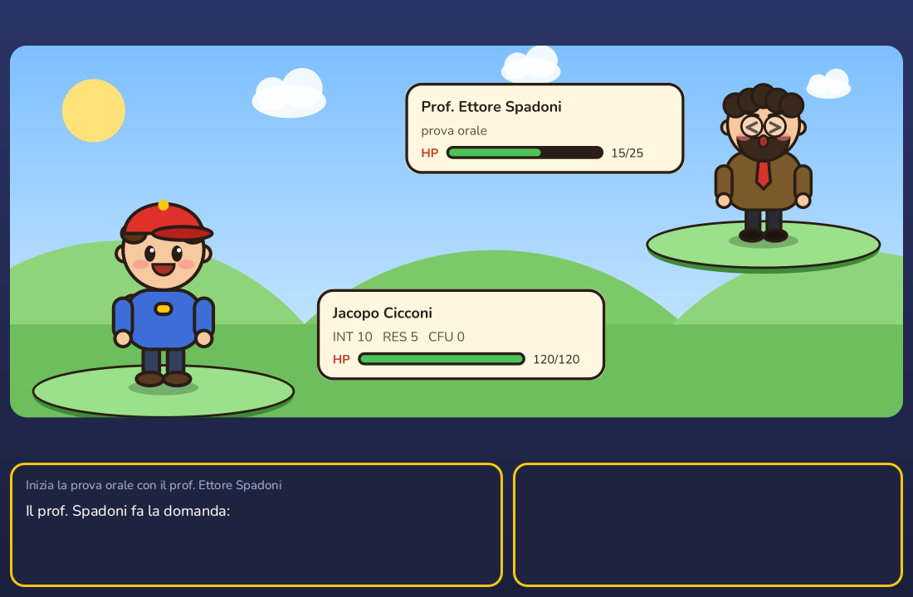
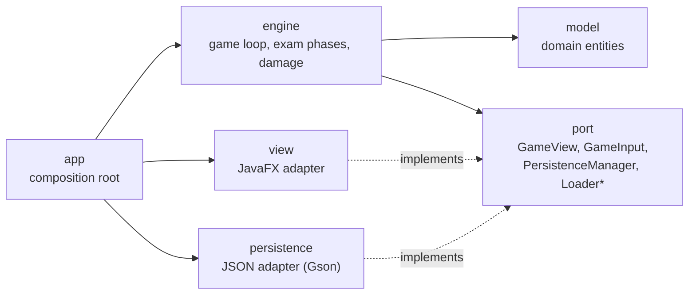

# 🎓 Unicum Laude


> A retro-style RPG where you play a Computer Science student who has to fight
> their way through the exams to graduate.
> Built in Java 25 + JavaFX for the *Metodologie di Programmazione* course
> (BSc Computer Science, University of Camerino).

<p align="center">
  
  &nbsp;
  
</p>

---

## 🎮 Gameplay

You walk through the rooms of the department on a world map in the style of
*Super Mario Bros. 3*. Exams are fought on a JRPG-style battle screen. Each exam room holds a professor, who is the boss you have to beat.

- **Exams in two phases.** The **written test** is a multiple-choice question
  drawn at random for that course. A wrong answer costs you stress (HP). The
  **oral exam** is a turn-based battle against the professor. If you pass both
  phases you get a grade from 18 to 30 and the course credits (CFU) go into your *libretto*.
- **Prerequisites.** Some exams unlock only after you pass the earlier ones, as in a real study plan.
- **Careers (Strategy pattern).** *Full-time*, *Worker* and *Out-of-course*
  students start with different max HP and money.
- **Items.** Coffee restores HP. Notes, textbooks and… *ChatGPT* boost your intelligence.
- **Study rooms** let you rest and recover HP.
- **Save / load.** The game state is saved as JSON in `~/.unicumlaude/`.
- **Win / lose.** You win when you reach the CFU needed to graduate. You lose if your stress makes you burn out.

The map and the question bank are **data-driven**. They load from
`src/main/resources/mappa.json` and `domandeEsami.json`, so you can add new rooms,
exams or questions without touching the code.

---

## 🏗️ Architecture

The project uses a **ports & adapters** (hexagonal) structure. The domain and
the game engine depend only on interfaces. JavaFX and JSON persistence are
adapters that plug into them.



| Package       | Responsibility |
|---------------|----------------|
| `model`       | Domain: `Studente`, `Professore`, `Esame`, `Mappa`, `Libretto`, items, careers |
| `engine`      | Game rules: `GameLoop`, `EsameController`, `ProvaScritta`/`ProvaOrale`, `CalcolatoreDanno` |
| `port`        | Interfaces and DTOs that the engine uses to talk to the outside world |
| `view`        | JavaFX GUI: menu, world map, JRPG-style exam screen, vector characters, CSS theme |
| `persistence` | Loading the map and questions, saving and loading the game, in JSON |
| `app`         | Composition root: builds the object graph and starts the game |

**Main design choices**

- **SOLID**, applied in concrete places:
  - Each exam phase is a separate `FaseEsame`, so you can add a new phase without changing `EsameController` (OCP).
  - The engine depends on `GameView` and `GameInput`, not on JavaFX (DIP).
- **Strategy pattern** for career types (`CareerStrategy`).
- **Threading.** The game loop runs off the JavaFX Application Thread. UI updates
  go back to that thread through `Platform.runLater`, so the interface never freezes.
- **Injected `Random`** in `EsameController`, so that grade generation is deterministic in tests.
- **Immutable DTOs** (Java records) between the engine and the view, so the UI never changes the domain.
- **Fail-fast validation** in constructors, and domain exceptions such as `BurnoutException` and `MovimentoNonConsentitoException`.
- **Graphics without image assets.** Characters are drawn with JavaFX shapes and have
  swappable facial expressions. Each professor's look is derived from their name,
  so new professors in `mappa.json` get their own face automatically. The exam
  screen queues engine events so that animations play in order. All styling lives
  in one CSS file.

---

## 🧪 Testing

The project has 110 JUnit Jupiter tests across `model`, `engine` and
`persistence`. They cover damage calculation, movement and prerequisites, the
exam phases, the game loop, and JSON save/load round-trips. Test doubles stand
in at the system boundaries (view, input, persistence).

```bash
./gradlew test
```

---

## 🚀 Getting started

**Requirements:** JDK 25. You do not need to install Gradle: the included wrapper downloads Gradle 9.3.

```bash
git clone https://github.com/JCicconi-31/UnicumLaude.git
cd UnicumLaude
./gradlew run        # Windows: gradlew.bat run
```

---

## 📁 Project structure

```
src/
├── main/
│   ├── java/it/unicam/cs/mpgc/rpg130525/
│   │   ├── app/          # composition root, JavaFX Application
│   │   ├── engine/       # game rules
│   │   ├── model/        # domain
│   │   ├── persistence/  # JSON adapters
│   │   ├── port/         # interfaces + DTOs
│   │   └── view/         # JavaFX GUI
│   └── resources/        # mappa.json, domandeEsami.json
└── test/                 # JUnit tests, mirroring the main packages
```

> Note: identifiers and in-game text are in Italian, as required by the course.

---

## 🤖 Use of AI tools

I used Claude (Anthropic) as a programming assistant for the following:

- discussing the architecture (SOLID, Strategy, package split)
- generating and reviewing some classes
- defining test cases
- finding bugs and code smells, for example integer division in the HP bar, threading in JavaFX, and duplicated code

I made the design decisions myself: scope, choices between alternatives, and
what to include. I reviewed every suggestion before using it, and the test
suite checks the behaviour. Classes written with AI assistance say so in their
Javadoc. The [repository Wiki](https://github.com/JCicconi-31/UnicumLaude/wiki)
describes in more detail how I used AI.

---

## 🎨 Credits

Fonts: [Nunito](https://github.com/googlefonts/nunito) for text and [Pixelify Sans](https://github.com/eifetx/Pixelify-Sans) for the title, both licensed under the SIL Open Font License 1.1 (see `src/main/resources/fonts/`).

---

## 👤 Author

**Jacopo Cicconi**, BSc Computer Science student @ UNICAM
[LinkedIn](https://www.linkedin.com/in/jacopo-cicconi) · [GitHub](https://github.com/JCicconi-31)
